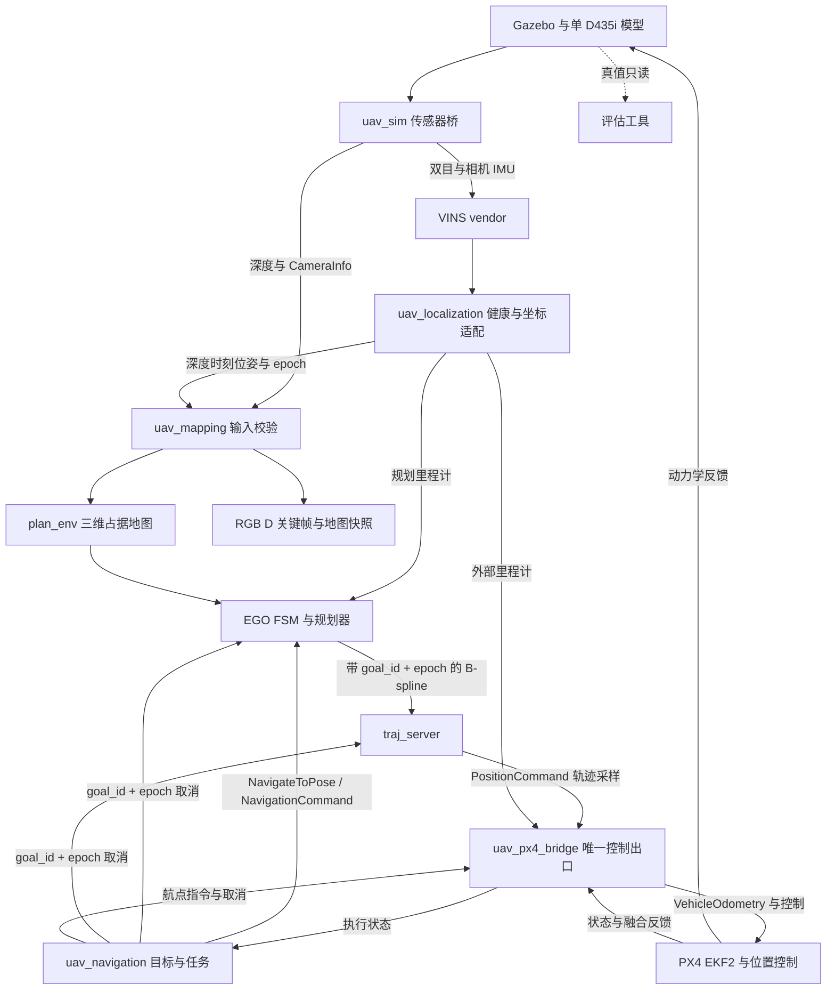

# 系统架构与启动链

## 三条独立链路

数据链：图像／IMU／深度 → 定位及地图。控制链：任务 → EGO／航点 → 唯一 Offboard 出口 → PX4。证据链：run manifest → 日志与指标 → progress/evidence → 阶段结论。

`uav_navigation` 的纯状态核心已连接 `NavigateToPose` action、EGO 目标话题和按 goal/epoch 匹配的取消话题。`traj_server` 采样最终 yaw，并沿原有唯一 `/position_cmd` publisher 对当前轨迹发布 ABORT；这条路径通过合成 ROS 集成测试。EGO 的在线目标规划、轨迹跟踪、PX4 bridge 和闭环飞行尚未验证，图中 PX4 链路仍是待交付边界。

VINS 的 body 是相机 IMU，不默认等于飞机 base_link。uav_localization 输出连续局部坐标，uav_px4_bridge 再处理飞控 NED／FRD、局部原点和航向对齐。两侧不得重复旋转或重复补偿杆臂。

地图以现有 plan_env 为唯一占据更新器。`uav_mapping/mapping_input_adapter` 按深度 stamp 插值优化位姿、使用 SDF 外参生成相机 PoseStamped，并在深度／定位健康无效或 epoch 变化时通过 reset 服务清除旧 map_id。合成 smoke 已验证定位失效清图。动态 run #08 观察到 233 组同 stamp 输入、最多 1,787 个占据点；单墙探索对照在一次 SE(3) 轨迹对齐后，墙面最近残差中位数 3.63 cm、P95 7.31 cm。点云发布时间戳使用 `/clock`，距最近 VINS 优化位姿 4 ms；这不是 map latency 测量。后续 run 已确认 reliable 优化里程计接入 EGO，planner 离开 INIT；规划尝试多数失败、仅一次成功，因此稳定响应、地图快照、unknown/free 分类与重影仍未验证。EGO 的 `traj_server` 输出自有 `uav_interfaces/PositionCommand` 轨迹采样；这不是 PX4 设定点。控制出口负责新鲜度、状态与模式，不重新优化轨迹，也不允许定位适配器发布控制。

## 启动依赖

1. 启动 Gazebo／PX4 SITL、DDS Agent、clock 与传感器桥。
2. 核对双目配对、IMU 覆盖、CameraInfo 和 TF，再允许 VINS 初始化。
3. 定位输出通过健康门控，建立 epoch 与地图；等待地图有新鲜观测。
4. 外部里程计进入 EKF2，确认状态有效、融合满足配置；就绪组合取决于 profile。
5. 启动任务与控制管理，预发送 Offboard 心跳、解锁、起飞、稳定悬停后交给 EGO。
6. 到达／取消／失败后按状态退出，保存报告和地图快照。

P1、P2 单独测试可不启动后续模块。已有 sensors、debug-truth EGO/PX4 与 VIO closed-loop EGO/PX4 launch；VIO 完整入口共享 config 和 SDF 参数源，并生成独立 session。当前 VIO launch 在 #171 首次进入 SITL，但尚未通过成功目标、障碍或长时验收。

## 组合隔离

debug_truth：真值用于定位调试，地图仍由深度生成。vio_mapping：地图与 EGO 使用 VINS，PX4 允许调试定位，仅为中间阶段。vio_closed_loop：地图、EGO 和 PX4 外部定位均使用 VINS，禁止 GPS 与真值位置辅助；允许真值只读评估。

不同组合不可同时运行；定位源选择在启动时完成，不在飞行中无提示切换。每次运行记录实际 profile 和订阅图，不能只凭配置名称宣称无真值依赖。

## 故障传播

- 深度／地图过期：停止接受新规划；定位仍有效时受控减速。
- 轨迹过期／规划失败：由控制管理明确进入保持或退出状态，不无限延用旧轨迹。
- 定位无效：取消自主任务，执行 PX4 退出与 Land 策略；不得依靠失效旧位姿悬停。
- epoch 改变／时间倒退：清除旧目标、轨迹和在线地图；人工重新进入任务。
- Offboard 丢失：按既定超时 Land，禁止自动重进。必须结合心跳与飞控状态验证，不能只停发位置设定点。

## 后续算法边界

未来信念模块读取关键帧、定位与地图查询，通过导航目标接口提交观察位姿。它不能发布 PX4 设定点。当前不创建信念算法包。
