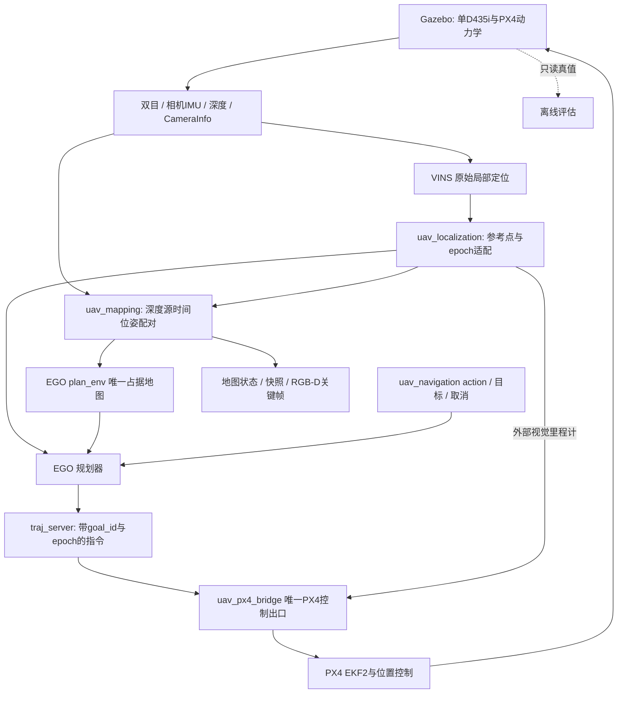

# 架构与控制边界

## 数据与坐标

双目和相机IMU来自同一D435i等效模型，VINS body为相机IMU。定位适配器保留源时间和连续局部坐标，地图输入按深度原始stamp在优化位姿之间插值，使用模型外参组合depth optical位姿。桥接器再完成PX4 NED/FRD、局部原点/yaw和IMU杆臂转换。评估在相同IMU参考点比较，不把Gazebo model-origin直接当作IMU位置。

当前理想相机IMU没有注入gyro噪声/偏置；0022可按该模型固定零gyro偏置，并同步处理初始化、优化和边缘化切空间。速度与加速度偏置仍自由，默认开关关闭、vins_sim明确启用。其他传感器模型和真实设备需要自己的标定，不继承此约束。

## 地图与规划

plan_env是唯一占据更新器。mapping_input_adapter转发源时刻深度/位姿，提供MapStatus与RGBDKeyframe，不注入世界几何。raw层区分unknown/free/occupied；膨胀层按当前配置供EGO判碰撞。官方乐观规划语义允许未命中inflated occupied的unknown参与规划，未知仍是未知。零/无效深度不合成free射线，越界和旧身份不当作普通unknown。

VINS session/epoch或时间完整性变化会使旧目标/轨迹和地图失效。只读快照绑定epoch、map_id、frame、源/融合/快照stamp及哈希，raw与inflated来自同一数组快照。RGB-D包含各自图像源时间位姿、CameraInfo和标定身份；MCAP可直接离线反序列化回读。持久数据回读不包含跨重启重定位功能。

## 任务与唯一控制出口

uav_navigation管理NavigateToPose、反馈、取消及目标替换；EGO输出带goal_id/epoch的B样条，traj_server发布PositionCommand。所有PX4设定点、OffboardControlMode和模式协调由uav_px4_bridge独占。定位、建图、可视化、记录和评估节点不发布PX4控制。

默认流程是启动未武装会话→PX4原生preflight/EV融合→独立垂直起飞→EGO目标→到达→正常降落上锁。项目不以残差、经验速度、连续健康等待、raw-known-free全包络或CPU/记录统计增加飞行分支。结构、epoch、frame、时间完整性和唯一控制所有者校验保持。ROS图可以有只读订阅者，不能因此把必需控制端点误判为缺失。

普通navigation结束后生成独立到达/接触/终态/唯一控制评估及qualification.json；只有源身份和所需数据齐全才通过。资源、VIO/地图/跟踪与净空数值按当前用户批准策略报告诊断。GUI、核心实际导航、零违规接触及正常终态仍为必要证据。

## 组合与验证范围

默认vio_closed_loop中，地图、EGO与PX4 EV均使用VINS。debug_truth组合保留独立调试用途；默认组合里的真值观察器只读，不回馈导航或控制。最终报告分别记录每个固定版本的构建、回放、GUI SITL及迁移证据；历史通过不自动计入受变更影响的新版本。

当前项目范围是低速静态室内单D435i仿真。用户排除故障专项及实机；现有PX4/EGO失效路径没有因此删除，未作完整故障资格承诺。语义、信念、自主探索及实机路线另行安排。
