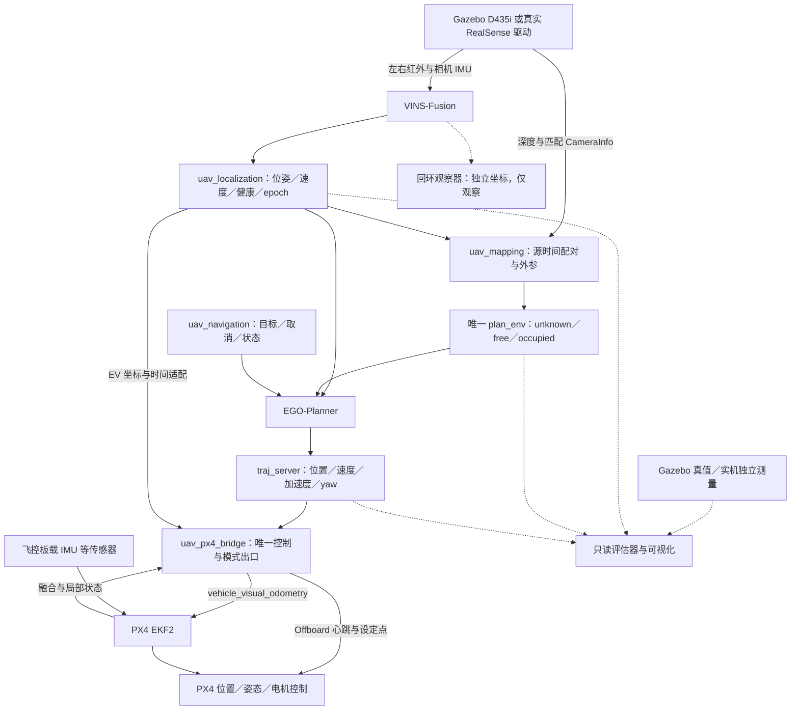

# D435i＋VINS-Fusion＋EGO-Planner＋PX4：仿真到实机路线

2026-11-02 实机推进更新：用户已要求实机迁移规划并授权SSH只读调查。当前Nano/Foxy、真实D435i与现有VINS基础已核实；后续具体选择、代码缺口及最小验证以[本机实机迁移执行方案](hardware-migration-plan-20261102.md)为准。以下保留历史路线，不将其中旧仿真缺口、20分钟/重复建议或旧unknown策略自动作为本轮新前置。本轮未启动实机配置或飞行。

日期：2026-10-22。性质：规划，未增加运行通过证据。

执行更新 #080：当前 [GOAL v3](../GOAL.md) 将剩余仿真任务细分为 [N01–N17](remaining-small-goals.md)，保留 S1–S6／A–H 出口；本文件继续描述完整架构和 H0–H5 后续路线，任务状态以 CURRENT／milestones 为准。

当前实施仍以 [GOAL](../GOAL.md)、[CURRENT](../progress/CURRENT.md) 和 [milestones](../progress/milestones.json) 为准；本方案补充实机迁移设计，不修改 P0–P6、S1–S6 或 A–H 的完成条件。真实设备配置和飞行属于后续阶段，本次不执行。硬件型号尚待确认，按单 D435i、室内、静态障碍、低速、人工指定三维目标与 yaw 设计。

## 1. 仓库实际起点

| 能力 | 已有证据 | 当前结论与缺口 |
| --- | --- | --- |
| 可构建与仿真传感器 | P0–P3 历史通过；固定 Jazzy／Harmonic／PX4 v1.17.0；异机重建和房间导航见 #054 | 保留已有实现；不同源码、参数、机器的结果分开判定 |
| 原始 VINS 精度 | #057 单次 16 m 任务位置 RMSE 4.56 cm、最大 9.01 cm；#069 重复返回新增位置漂移 1.85→3.73→5.72 cm、yaw 0.248→0.424→0.655° | 已测到累计误差；平滑、TRACKING 和低优化代价均不能代替精度评估 |
| 回环修正 | #075 同轮 raw／回环位置 RMSE 7.01→4.82 cm；末次返航 yaw 仍 1.287°；#077 单独提高 yaw 权重使位置指标回归 | 独立观察器有收益，重复性和位置／yaw 权衡未解决；不具备在线接管资格 |
| 占据建图 | 唯一 EGO plan_env；深度源时间配对；raw 快照；#063 射线修复；#065 扫描后一个 0.5 m 球全 free | 一个球或一次墙面拟合不能证明起飞、整条通道、降落区域和完整覆盖 |
| 规划与飞行 | 历史固定房间 16 m 导航成功；#062 在线目标球准入；#064 整条曲线检查与组件补证 | 后续实现改变安全行为，旧成功不自动成为当前版本资格；起降、制动和故障净空待验收 |
| 实机 | 尚无本仓库对应的传感器、标定、机载满载和实际飞行验收 | 仿真 250 Hz IMU、SDF 外参和 x86 容器不代表真实 D435i／机载平台已验证 |

依据：[原始漂移](../progress/evidence/vio-drift-baseline-20261022-057.md)、[重复返回](../progress/evidence/odometry-drift-20261022-069.md)、[回环比较](../progress/evidence/loop-drift-evaluation-20261022-075.md)、[yaw 权重重放](../progress/evidence/loop-yaw-weight-replay-20261022-077.md)、[目标准入](../progress/evidence/goal-admission-20261022-062.md)、[完整曲线补证](../progress/changes/2026-10-22-064-full-curve-admission.md)。

部分模块 README／架构文档仍保留早期实验描述。发生状态差异时，使用 CURRENT 和对应版本证据判断，不把早期“尚未接入”或历史“成功”直接套用到当前工作树。

## 2. 固定系统分工与控制出口



VINS 使用 D435i 自带 IMU；PX4 内环继续使用飞控自身 IMU。两者职责独立，不把 D435i IMU 当成飞控电机内环的替代输入。首版沿用 EGO 轨迹采样加 PX4 位置控制，不同时引入新的姿态控制器或 MPC。

| 边界 | 当前接口 | 仿真与实机共同要求 |
| --- | --- | --- |
| 传感器→VINS | `/sensors/d435i/infra1/image_rect`、`infra2/image_rect`、`imu` | 相同话题契约；真实驱动 remap／必要格式适配；不改源 stamp 伪装同步 |
| VINS→在线消费者 | `/localization/optimized_imu_odom`、`imu_odom`、`status` | 区分优化与传播状态；绑定 epoch、源龄、坐标与健康 |
| 深度→地图 | `/drone_0_depth_image`＋`/drone_0_camera_pose` | 同一深度源 stamp；有界插值位姿；匹配深度光学 frame 与内参 |
| 地图查询 | `/mapping/get_map_status`、`get_occupancy_snapshot`、`query_occupancy_sphere` | 以实际运行服务名为准；绑定 epoch／map_id／frame／融合新鲜度，失败拒绝 |
| 用户→导航 | `/navigation/navigate_to_pose` | 三维位置、yaw、取消、替换、超时与终态反馈 |
| 规划→控制桥 | `/position_cmd` | goal_id／epoch／有效时间一致；参考连续；整条轨迹准入 |
| 控制桥→PX4 | EV、OffboardControlMode、TrajectorySetpoint、VehicleCommand | 所有发布与模式协调仍归唯一 bridge；记录运行时版本话题名 |

完整字段以 [contracts](contracts.md) 和实际接口定义为准。真实传感器的 TF 发布权限也需核对，避免 RealSense 驱动和项目重复发布同一条变换。

## 3. 三类能力分别出具证据

### 3.1 定位：测量位置、姿态和速度误差

先验证 VINS 输入与状态连续性，再比较独立参考。EuRoC 可作为构建或算法回归用例，不必重走已经完成的所有步骤，也不替代当前仿真模型和真实设备标定。

评估同时保存 raw VINS 和回环观察器输出，采用同一开始时段的固定刚体对齐、固定尺度 1，闭环后不再对齐。局部重力系的初始 yaw 自由，不能因为参数写 ENU 就认为已经与地理东向或 PX4 原点一致。

| 指标 | 用途与报告方法 |
| --- | --- |
| 位置 ATE：RMSE／P95／最大／终点误差 | 整体误差；报告对齐窗口、覆盖率和失配样本 |
| 固定时间／距离窗口 RPE | 区分短时估计误差和长期漂移；同时报告平移与旋转 |
| 姿态与速度误差 | yaw、roll/pitch、速度向量误差；速度需先统一表达坐标 |
| 重复返回漂移 | 在参考确认回到相同真实位置／朝向时比较每次误差，避免只以 VINS“回到原点”判定 |
| 连续性与时序 | 优化／传播的频率、P95/P99 源龄、最大空窗、跳变、初始化和 reset |
| 运行质量 | 特征数量／分布／寿命、偏置、优化耗时、分组残差；作为诊断，不替代独立误差 |

测试运动包括静止、平移、升降、缓慢 yaw、往返、重复纹理和弱纹理。仿真参考来自隔离真值；实机优先使用只读动捕等参考。已测量路标和闭合路线只能提供局部／端点约束；缺少参考时不能宣称全程绝对位置、姿态和速度精度已经通过。

### 3.2 建图：测量障碍、自由空间和未知空间

分两步排查：在显式 debug_truth 组合中隔离深度投影／外参／射线几何；随后在同类场景使用 VINS 位姿评估整个链路。真值输入只在调试组合，最终在线地图不读完整世界几何。

使用单墙、量测箱体、柱体和门洞，记录墙面残差、障碍位置偏差、厚度／重影、有效覆盖、错误 free、occupied 漏检，以及采样到实际融合的延迟。必须检查“障碍前自由射线、表面占据、表面后仍未知”，不只统计点数或拟合最近表面。

保存同 epoch／map_id 的多时刻 raw 体素快照及独立 inflation mask，包含 frame、分辨率、边界、源 stamp、融合时间、K、外参和配置哈希，实际回读。无效深度、玻璃／反光／黑色材质／近距离盲区均须单独评估；看不到时保留未知或拒绝任务，不能清成 free。

真实深度的 encoding、depth scale 和光学 frame 必须按锁定驱动核对。当前约定 32FC1 米；若设备输出 16UC1，显式转换并保留源时间及标定身份。使用原生深度与其 CameraInfo；若做对齐，必须同时换成对应投影模型，不能拿 RGB 内参解释原生深度。

### 3.3 规划：验证整条可执行轨迹与实际机体

把三种结果分别报告：规划器产生候选、候选通过地图与动力学检查、飞机实际执行完成。目标准入通过只说明端点当时可用；一条安全中心线也不能证明含桨机体安全。

准入覆盖 A*、优化、最终活动曲线、重规划衔接、制动／保持段和起降。unknown、越界、旧 map_id 和查询失败都明确拒绝。连续扫掠采用完整机体或保守包络，并给出离散采样间隙的覆盖依据；检查控制点不足以证明曲线安全。

地面接触和自身过滤必须按物理几何、起降状态及已知区域定义。当前前向相机可能无法观察起飞机体周围完整包络；先解决这一入口条件，不能通过任意起点半径豁免或填空未知取得通过。仿真支架／手持扫描得到的已知区不能自动变成可飞行起飞证明。

## 4. 从当前版本推进到正式仿真验收

| 顺序 | 要完成的工作 | 出口证据 | 对应现有阶段 |
| --- | --- | --- | --- |
| 1 | 固定当前源码／补丁／镜像／参数／运行负载；列出受 #062–#064 影响需回归的历史结果 | 唯一 manifest、实际订阅图、无在线真值／GNSS辅助、控制发布者审计 | P0 回归，S1 基础 |
| 2 | 独立定位基线与输入健康；对比 no-goal hold、EGO 仅计算、实际跟踪的受控组 | 同版本误差、时序、状态连续性；原健康门不放宽；独立冷启动重复 | P2 回归，S1–S2 |
| 3 | 明确起飞／自身／地面规则；确认深度实际融合连续；至少两种布局检查 raw 地图与完整机体曲线 | 新鲜地图快照、unknown／边界处理、全曲线扫掠和运行开销；允许轨迹明确可执行 | P4，S3–S4 |
| 4 | 验证 VINS→EKF2 实际融合、原点／航向与外参；完成短距离、不同 yaw、高度变化和取消／替换 | ULog EV aid／innovation／reset、参考切换连续、实际到达与落地上锁 | P5，S2／S5 |
| 5 | 根据独立测量冻结一套验收配置 | 参数理由、测量方法、适用场景、源码／配置哈希；更改后重跑受影响项 | GOAL F，S5 |
| 6 | 正常场景、不可达目标、故障与长时完整验收，重新生成可交付版本 | A–H 报告、全部正式 run、失败记录、重建和用户操作文档 | P6，S6 |

步骤可开展不执行轨迹的并行准备；任何位移飞行前须满足该动作的安全入口。S1 无目标悬停也需核对起降与保持区域，不能因诊断目的免去安全条件。

正常场景按 GOAL：空场、单障碍、错位多障碍、膨胀后可通行窄道，每类 3 次独立冷启动、全部成功且零碰撞；另测不可达目标。至少一个场景起终点直连被挡，实际绕行，组合覆盖不同高度与 yaw。

故障按 GOAL：双目断流、相机 IMU 断流、深度断流、VINS 重启、规划器退出、时钟回退，各至少 2 次独立注入。保留连续 10 分钟完整负载与实际任务／重规划要求，记录墙钟和仿真时间，不能用低 RTF 的 10 分钟仿真声明机载实时能力。

## 5. 安全预算决定速度与通道宽度

以下是待测量并冻结的设计方法，不是对当前参数的认证。

对球包络示例，定义 `r_body` 为含桨及附件的保守外接半径，`e_loc` 为适用时间／距离内的定位误差预算，`e_map` 为地图误差，`e_track` 为跟踪偏差，`e_grid` 为体素离散覆盖误差：

```text
R_required = r_body + e_loc + e_map + e_track + e_grid + margin
d_stop = v * tau_total + v² / (2 * a_brake_min) + d_extra
D_free_ahead >= R_required + d_stop
W_corridor >= 2 * R_required
```

`tau_total` 覆盖最坏可接受感知源龄、融合、规划、桥接和执行响应，避免重叠统计；`a_brake_min` 用目标平台实测的保守减速度，`d_extra` 覆盖加加速度限制、扰动和模型余量。自由距离须在运动方向上对机体扫掠区域成立，单条相机中心射线不够。体素项依实际几何检查是否已经覆盖而定；raw 球检查与 inflation 不能重复计入机体半径，也不能两边都遗漏。

当前配置的速度 0.5 m/s、加速度 0.8 m/s²、膨胀 0.5 m、地图超时 0.4 仿真秒均为 PROVISIONAL。它们是仿真候选，不是实机速度／制动证据。GOAL 已规定的到达起点为位置 ≤0.30 m、yaw ≤15°、持续 ≥3 s；独立真实误差也须报告，不能只看同一 VINS 坐标里的自洽到达。

前向相机首版限制侧飞、倒飞和快速转向。转弯先验证保持区和旋转时整个机体包络，再观察运动方向、等新鲜融合后规划；有地图历史也要考虑漂移和观测年龄。任意远端目标落在未知空间时，应明确返回未观测原因或等待受限观察流程；不能把未知端点直接转发给 EGO，也不在本轮引入自主探索。

## 6. 真实 D435i 的地面验证

本阶段可以在仿真验收期间准备台架和录包，但不启用真实飞行控制。真实标定与 SDF 仿真标定分开，按设备／安装版本保存单一来源。

1. **设备与驱动锁定**：记录相机／固件、USB 控制器与速率、内核、librealsense、realsense-ros、ROS、CPU 架构、供电和线缆；只用预期驱动占有 IMU，复查 HID／SDK 冲突。
2. **纯输入连续性**：先 20 分钟左右红外、深度、gyro、accel、合成 IMU 连续记录，冷启动至少 3 次；统计配对误差、源时间单调性、P99 间隔、丢帧和热状态。实际支持频率以枚举及测量为准，不能把仿真 250 Hz 写成实机指标。
3. **标定**：固定分辨率和图像是否已矫正，核对左右 K／畸变／基线、相机到 IMU、深度到相机、IMU 轴向／噪声／偏置、相机与 IMU 时差。官方 D435i YAML 仅供配置结构参考，其数值不直接作为本机标定。
4. **投射器与曝光对照**：固定照明／曝光条件，比较真实红外特征与深度有效率，再决定 emitter 设置。既评估视觉稳定性，也评估关投射器后低纹理深度损失；不把某个设置当通用答案。
5. **手持定位**：静止、直线、升降、yaw、闭合与重复往返，使用独立参照比较位置／姿态／速度；保留实时与离线回放两种结果。回放只能验证对应输入及调度条件。
6. **真实建图与离线规划**：测量墙体、箱体与通道，生成并回读 raw 快照；用未接控制的规划输出做整条包络检查，验证失效门控与 epoch。

[RealSense ROS 官方说明](https://github.com/realsenseai/realsense-ros)中 `unite_imu_method=2` 是把加速度插值到 gyro 时间，合成流按 gyro 频率发布。它不证明图像／IMU已消除时差，也不等于硬件同步。实际启动参数和话题名以冻结驱动为准。

[VINS 官方 D435i 双目惯性配置](https://github.com/HKUST-Aerial-Robotics/VINS-Fusion/blob/master/config/realsense_d435i/realsense_stereo_imu_config.yaml)明确使用两路图像与 IMU；本仓库继续使用已锁定的 ROS 2 移植及补丁，不再引入第二份同名算法。[D435i SDK 文档](https://github.com/realsenseai/librealsense/blob/master/doc/d435i.md)说明设备的时间与 IMU 标定机制，需结合实际 SDK／ROS frame 核对，不能根据外壳方向猜坐标。

## 7. 机载计算、坐标与时钟迁移

### 7.1 先证明目标计算机可实时运行

目标平台运行相机、VINS、地图、EGO、导航、bridge 和必要记录，Gazebo 在开发机运行，RViz 可作为只读远端界面。飞行核心留在机载有线链路，遥测网络断开不应切断机载控制。先记录无 GUI 和必要观察负载，再验证最终负载，不把停掉规划器的性能当整套性能。

固定 ARM64／x86_64 的构建和依赖清单；现有 x86 镜像无法直接证明 ARM64 可用。测 CPU 单核／总负载、RSS、温度／降频、USB 带宽、I/O，以及图像到控制 P95/P99 延迟和最大空窗。至少完成 20 分钟地面完整负载，无无界积压；再开展飞行。

如果仍使用原版 Jetson Nano，先核对系统与驱动支持。其传统 JetPack 4.x 栈与本仓库 Jazzy 栈存在平台迁移工作：[NVIDIA JetPack 4.6.2 页面](https://developer.nvidia.com/embedded/jetpack-sdk-462)列出 Nano 及 Ubuntu 18.04 基础；[ROS Jazzy 安装文档](https://docs.ros.org/en/jazzy/Installation/Ubuntu-Install-Debs.html)对应 Ubuntu 24.04。容器不能自动解决宿主内核、USB 和架构兼容。根据本机满载测量决定保留或更换平台，不在未测量前认定 Nano 足够／不足，也不为适配旧机直接重写整套 ROS 架构。

### 7.2 真实安装外参与杆臂

当前里程计 child 是 D435i IMU；必须明确 `base_link`（FLU）、PX4 机体系（FRD）、相机 optical 与相机 IMU 的刚体关系。机体参考点与 PX4 接口的参考点分别记录，位置／姿态／线速度／角速度一起核对，尤其检查旋转时 `omega × lever_arm` 速度项。

选定唯一杆臂补偿责任：桥接转换为约定参考点，或按 PX4 该版本支持的传感器位置方式处理；不得在 bridge 和 EKF2_EV_POS_* 同时补偿。仅改 frame_id、交换位置 XYZ 或只改 yaw 都不足以证明姿态与速度正确。真实相机 IMU 轴可能不等于当前仿真假定的 FLU。

检查初始化时 VINS 局部原点／yaw 与 PX4 local frame 的变换是否稳定，分别做三个轴正负平移和慢旋转。禁止使用动捕／真值对齐结果作为最终在线定位初始化。真实标定、静态 TF、VINS 和地图配置从同一真实安装配置生成，不复制 SDF 数值。

### 7.3 实机时间域与 EKF2

当前共享 bridge 配置含 `px4_clock_domain=gazebo_lockstep`、`uxrce_dds_time_sync_enabled=false`，VIO profile 消费 `/clock`。实机必须新增经过验证的运行 profile 和相机时钟→ROS→PX4 时间映射，在线使用真实时间；不能照搬 lockstep，也不能简单删除时钟检查。

分别记录采样时间 `timestamp_sample` 和发送时间 `timestamp`，核对实际 uXRCE-DDS 同步设置，避免双重校时。真实设备拔插、时钟跳变和重连建立新 epoch，取消旧任务和清图。[PX4 外部定位文档](https://docs.px4.io/main/en/ros/external_position_estimation.html)列出 EV 融合、延迟和传感器位置配置；实际取值与消息字段以仓库锁定 v1.17 源码及目标飞控固件为准。

当前 VINS 无有效位姿协方差，`covariance_valid=false`；桥内固定方差是候选配置。用独立测量、延迟和创新记录校准 EV 噪声模型，不把零协方差或固定 quality=100 解释为测量置信度。ULog 检查 EV aid 实际融合、拒绝、innovation／test ratio、reset 和状态有效性；仅存在输入话题不算通过。

首版继续使用现有 bridge 20 Hz 控制频率作为待验证起点。[PX4 v1.17 Offboard 文档](https://docs.px4.io/v1.17/en/flight_modes/offboard)规定进入前持续提供存活信号，丢失按超时退出；其最低心跳要求不等于轨迹跟踪频率足够。按实测轨迹与链路抖动决定是否调整，并固定 `COM_OF_LOSS_T`、`COM_OBL_RC_ACT` 与人工接管行为。无 GNSS 目标不意味着禁止飞控自身 IMU／气压计等可用传感器；实际辅助源须清楚记录。

## 8. 实机按台架、融合、悬停、导航递进

下表为后续拟定阶段，不重命名现有 P0–P6，也不构成实机启动授权。每阶段参数先冻结，失败修复后重新计算连续成功次数。

| 阶段 | 动作 | 进入下一阶段的条件 |
| --- | --- | --- |
| H0 台架与录包 | 完成第 6 节；机载满载实时运行；不接电机控制 | 设备、标定、定位／地图误差、持续性和故障门记录完整 |
| H1 拆桨飞控联调 | 真实 PX4 通信与 EV 融合；检查轴向、参考点、时间、控制唯一性和失效状态 | ULog 证实融合；桥接命令／模式正确；遥测与断链路径可重复；实机配置与仿真隔离 |
| H2 受控悬停 | 人工先确认飞控基础飞行；再视觉辅助保持／Offboard 无目标保持与降落 | 每项至少 3 次独立启动；量化漂移、跟踪、振动、延迟、落地和上锁；有独立监护与接管 |
| H3 空场短目标 | 小距离明显位移、缓慢 yaw、升降、取消／替换、到达与返程 | 满足预先冻结的真实误差、净空和时序预算；侧后方运动受观测约束 |
| H4 单障碍再多障碍 | 经量测且已满足机体通行条件的静态布局，直连受阻、实际绕行 | 每布局至少 3 次独立启动、无碰撞、净空满足预算；规划与机体实测轨迹均归档 |
| H5 有界运行交付 | 逐步扩展任务时长、布局和轻度环境变化 | 明确可用速度／照明／纹理／材质／通道／任务时距范围；超过边界可拒绝；证据可复查 |

初次飞行使用受控场地与足够净空，具体高度、速度和尺寸在 H0/H1 后按实测预算确定；可把 0.2 m/s 作为地面设计候选，不能据此直接批准飞行。试飞先空场再有障碍；不把未经验证的“自动降落”当作任意环境下安全兜底。

双目／IMU断流、进程退出、通信丢失等严重故障先在回放、SITL 和拆桨台架验证；真实空中故障试验逐项制定边界与恢复条件，不在首飞中照搬全部 SITL 注入。真实缺少 Gazebo 时钟回退时，用地面模拟的时间异常验证相同会话失效契约。

H5 是有限场景工程交付，不承诺永久无漂移、动态避障或任意室内飞行。无外部绝对约束的长期全局定位需另立后续目标。

## 9. 回环的推进条件

短时闭环先保持连续局部 `odom_<epoch>`。回环观察器继续独立 frame，不向 PX4 或地图反馈；当前 #078 的离线鲁棒核拆分实验仍为原待确认事项，本规划不代为批准或启动。

只有在固定场景与多 fresh epoch 中证明位置和 yaw 改善、无错误回环、资源与时延有界后，才讨论在线使用。后续设计可将全局修正表达为 `map→odom`，局部地图与控制保持连续；还需定义目标转换、全局修正时的重规划，以及历史观测是否需要重积分。不能把跳变修正位姿直接塞入已有局部栅格，或仅平滑位姿而不处理旧地图。

因此回环是扩展可靠任务时距的候选能力，不是开始验证局部避障的前提，也不能当作不漂移保证。首版须通过原始 VIO 的适用时距和误差预算约束任务。

## 10. 故障行为与证据包

| 情况 | 要验证的行为 | 结果证据 |
| --- | --- | --- |
| 深度／地图过期，定位仍有效 | 拒绝新目标，失效当前轨迹，使用已检查的制动／保持段；周围空间不确定时进入既定退出策略 | 检测延迟、制动距离、真实机体轨迹与净空 |
| 轨迹超时／规划器退出 | 不继续旧轨迹；bridge 受状态机控制保持或退出 | 最后有效命令、状态转换、PX4 实际状态 |
| VINS 丢失／重启 | 取消目标和轨迹，清图，退出自主；不靠旧 VINS 位姿继续定点；按 PX4 能力与人工接管条件处理 | 实际水平漂移、下降、落地／上锁；Land 命令本身不算成功 |
| epoch／时间异常 | 旧身份全部拒绝，新会话重新初始化，禁止自动续飞 | 旧消息拒绝、map reset 确认、重新使能流程 |
| bridge／机载通信丢失 | PX4 执行预设 Offboard-loss 行为 | 心跳中断、超时、模式及最终运动结果 |

每个 run 至少保留：源码 HEAD＋相关脏树快照、vendor 基准与补丁哈希、镜像／构建架构、配置与标定哈希、实际 ROS graph／PX4 参数、run_id／epoch／map_id／goal_id、原始时间和 monotonic 接收时间、VINS／地图／轨迹／控制／PX4 日志、ULog、地图快照和独立评估报告。按阶段选择图像录包负载；录包影响性能时纳入最终负载或量化差异。

仿真接触／几何评估只在隔离评估工具读取完整场景；实机参考也只读。大产物放 `artifacts/runs/<run_id>`，轻量报告放 `progress/evidence` 并引用相对路径与 SHA-256。分别标明结构、构建、回放、SITL、实机证据。

## 11. RViz 与下一批工作

RViz 建议显示 raw VINS 路径、当前稀疏特征、raw occupied＋膨胀层、目标与 EGO 曲线、机体包络与实际跟踪路径；仿真额外叠加仅供评估的真值路径。unknown／free／边界、地图融合龄、epoch 和健康状态也需可检查。回环路径使用独立 frame，若需叠加只在评估显示里应用固定对齐，不向在线 TF 注入真值变换。

现有 `config/rviz/mapping.rviz` 和 `loop_observer.rviz` 是起点，尚不等同上述完整显示。RViz 是观察工具；数值与归档证据决定阶段结论。

当前最有价值的下一批产物，按依赖推进：

1. 当前固定版本的三类验收矩阵与受影响回归清单，先声明误差／净空／时序指标及测量方法。
2. 起飞／地面／自身过滤与观察盲区的明确几何方案，结合连续融合地图和全曲线检查完成 S3–S4；未通过的动作不进入飞行。
3. 当前 VIO 的位置、姿态、速度和重复返回误差报告，与原健康门问题分开论证；控制切换按 S1–S2 受控对比。
4. 根据实测预算冻结验收配置，完成 S5–S6；并行准备真实 D435i 的 H0 录包、标定及目标平台兼容性清单。
5. 确认飞控／固件、机载电脑／系统、含桨尺寸、安装方式、独立测量和试验场地，再把 H0–H5 细化成实机执行文档。

本方案不设无证据的日历工期。每个出口通过后再承诺下一阶段的飞行范围；若后续更改源码或阈值，记录影响并重跑相应证据。
